<p align="center">
  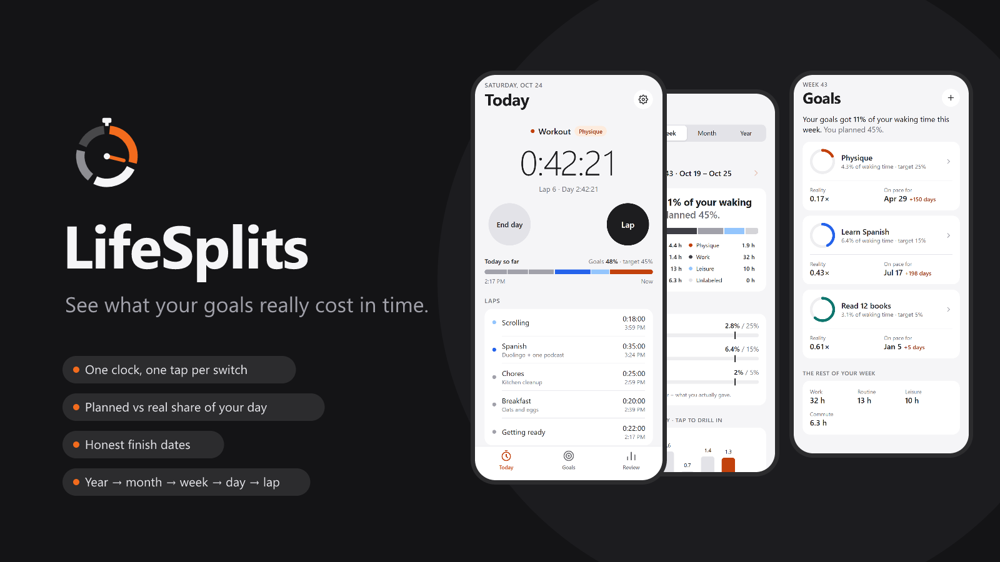
</p>

<h1 align="center">LifeSplits</h1>

<p align="center">
  <b>One stopwatch for your whole day.</b><br>
  Tap <b>Lap</b> whenever you switch activities, and find out how much of your life really goes to your goals —<br>
  and when you'll actually reach them.
</p>

<p align="center">
  
  
  
  
  
  
</p>

<p align="center">
  <a href="#-the-idea">The idea</a> ·
  <a href="#-see-it-in-action">See it in action</a> ·
  <a href="#-quick-start">Quick start</a> ·
  <a href="#-how-to-use-it">How to use it</a> ·
  <a href="#-a-tour-of-the-app">Tour</a> ·
  <a href="#-how-the-numbers-work">The math</a> ·
  <a href="#-project-structure">Code</a> ·
  <a href="#-roadmap">Roadmap</a>
</p>

---

## 💡 The idea

A friend used to time his whole day with a phone stopwatch. He'd start it when the day began and hit **Lap** every time he finished something — breakfast took 20 minutes, the kitchen 25, and so on. By evening he knew exactly where his hours went.

LifeSplits turns that habit into a goal tool:

> You say *"I'll get in shape in 2 months."* That's **calendar time**.
> Goals are reached in **invested time** — the hours you actually put in, between work, chores, sleep and scrolling.
> LifeSplits measures the second and tells you what it means for the first:
>
> **"You planned 60 days. You're giving Physique 10% of your waking time, not 25% — at this pace it's 90 days."**

| ⏱️ One clock, all day | 🎯 Goals get a share | 📉 Plans meet reality | 🔎 Drill up and down |
|:--|:--|:--|:--|
| The clock never stops, so every minute is accounted for — not just the ones you remember to log. | Give each goal a share of your waking time (say 25%) and a rough number of hours. | See planned vs real share, a *reality ratio*, and an honest finish date from your real pace. | Zoom from a year to a month, a week, a day — down to a single lap and its note. |

## 🎬 See it in action

<p align="center">
  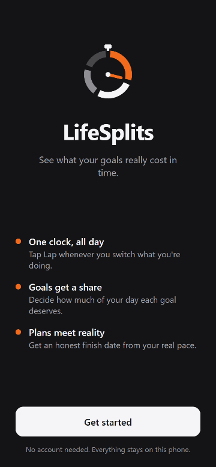
</p>

<p align="center"><sub>Welcome → guided intro → a running day → labelling a lap → goals → plan vs reality → weekly review → one day, lap by lap → dark mode</sub></p>

## 🚀 Quick start

### 1. Prerequisites

| You need | Version | Check with |
|---|---|---|
| [Node.js](https://nodejs.org) | current LTS (built and checked with 24) | `node -v` |
| npm | comes with Node | `npm -v` |
| [Git](https://git-scm.com) | any recent | `git --version` |
| A phone with **Expo Go** | latest from the [App Store](https://apps.apple.com/app/expo-go/id982107779) / [Google Play](https://play.google.com/store/apps/details?id=host.exp.exponent) | — |

You don't need Xcode or Android Studio to try the app — Expo Go runs it on your phone.

### 2. Install

```bash
git clone <your-repo-url> stopwatch_app
cd stopwatch_app/mobile   # the app lives in mobile/ — that's where package.json is
npm install
```

### 3. Run

From the same `mobile/` folder:

```bash
npx expo start
```

`npm start` does the same thing. Note it's **`npx`** (runs a package's command), not `npm` — `npm expo start` fails with *Unknown command: "expo"*.

> Already at the repo root? `npm install` and `npm start` work there too — they forward to `mobile/`.

A QR code appears in the terminal:

- **Android** — open Expo Go and tap *Scan QR code*.
- **iPhone** — point the Camera app at the QR code and tap the banner.

Your phone and computer need to be on the same Wi-Fi. If they can't see each other, run `npx expo start --tunnel`.

### 4. Explore without waiting weeks for data

On the last intro step tap **Explore with sample data** — you get three goals and three weeks of realistic laps, so every chart has something to show. You can also load it any time from **Settings → Load sample data**, and wipe it with **Settings → Erase all data**.

<details>
<summary><b>Other ways to run it</b> (emulator, simulator, browser)</summary>

| Target | Command | Needs |
|---|---|---|
| Android emulator | `npm run android` | Android Studio with an emulator running |
| iOS simulator | `npm run ios` | macOS with Xcode |
| Web browser | `npm run web` | nothing extra — good for a quick look at the UI |

On web, data is kept in the browser's `localStorage` and the tab bar is a web stand-in; on phones it's SQLite and native tabs.

</details>

<details>
<summary><b>Build a real app (APK / TestFlight)</b></summary>

Builds run in the cloud with [EAS](https://docs.expo.dev/eas/):

```bash
npx eas-cli@latest login
npx eas-cli@latest build:configure
npx eas-cli@latest build --platform android --profile preview   # installable APK
npx eas-cli@latest build --platform ios                          # needs an Apple Developer account
```

The app identifiers are `app.lifesplits` for both stores (see `app.json`).

</details>

<details>
<summary><b>Troubleshooting</b></summary>

- **`Could not read package.json` / `Unknown command: "expo"`** → you're in the wrong folder or typed `npm` for `npx`. Run `cd mobile`, then `npx expo start`.
- **The QR code won't connect** → use `npx expo start --tunnel`, or make sure both devices are on the same network and no VPN is on.
- **"Incompatible version" in Expo Go** → update Expo Go; this project targets SDK 58.
- **Weird dependency errors** → run `npx expo install --fix`, then `npx expo-doctor`.
- **Stale screen after editing code** → press `r` in the terminal to reload, or `npx expo start -c` to clear the cache.

</details>

## 🧭 How to use it

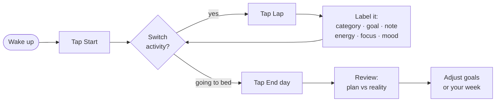

1. **Start the day.** On *Today*, tap **Start** when you wake up. The clock runs until you end the day.
2. **Lap at every switch.** Finished breakfast? Tap **Lap**. A sheet asks *"What was that?"* — pick a category (your usual ones come first), and it fills in which goal it counts toward. Add a note or rate energy, focus and mood (five emoji, from angry to excited) if you like. Review turns those ratings into patterns — which activities lift your mood, and when your energy peaks. The next lap is already running.
3. **Give goals a share.** On *Goals*, tap **+**. Name it, pick a target date, guess the hours it needs, and decide what share of your waking time it deserves. The form tells you right away whether that plan fits.
4. **Check the reality.** *Goals* shows your real share vs target for each goal, plus the date you'll actually finish. *Review* breaks down any day, week, month or year.
5. **End the day.** Tap **End day** before sleep. Forgot to lap for a while? Tap any lap to fix it later.

> [!TIP]
> Each part of the app shows a one-time tip card the first time you open it. Want them back? **Settings → Replay the intro**.

## 📱 A tour of the app

### First launch — welcome and guided intro

No sign-up: open the app, read five short steps, and you're in.

<table>
  <tr>
    <td align="center"><br><sub><b>Welcome</b></sub></td>
    <td align="center">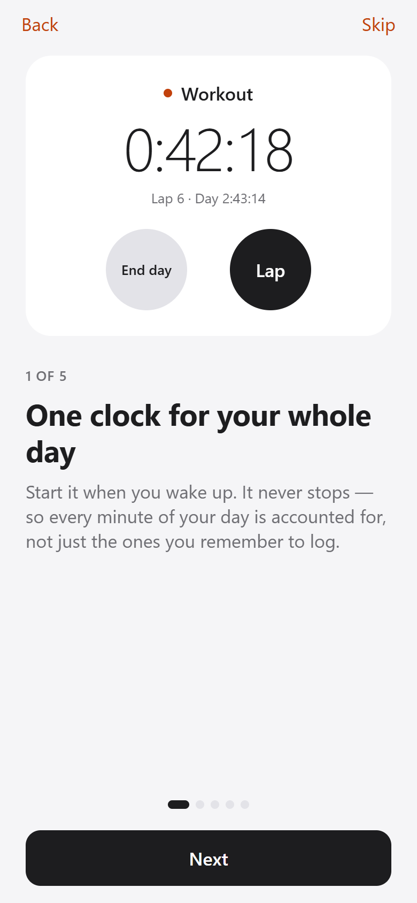<br><sub>1 · One clock</sub></td>
    <td align="center">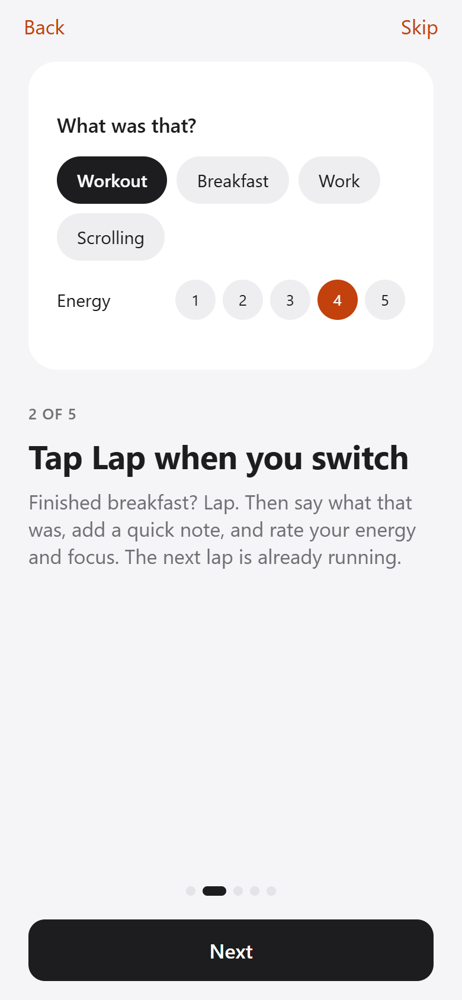<br><sub>2 · Tap Lap</sub></td>
    <td align="center">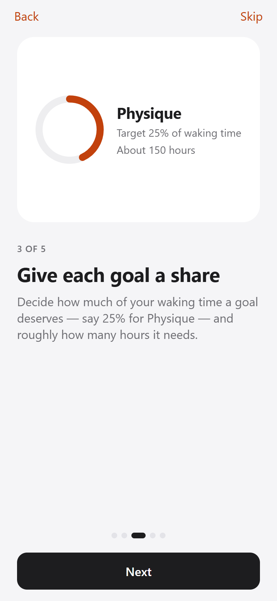<br><sub>3 · Goal share</sub></td>
    <td align="center">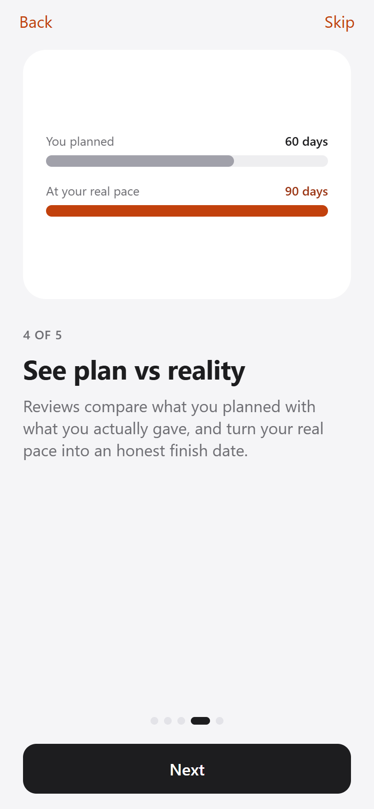<br><sub>4 · Plan vs reality</sub></td>
    <td align="center">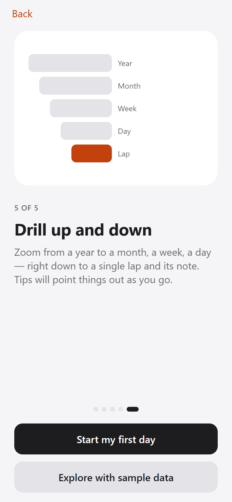<br><sub>5 · Drill down</sub></td>
  </tr>
</table>

### Today — the clock

<table>
  <tr>
    <td align="center" width="33%">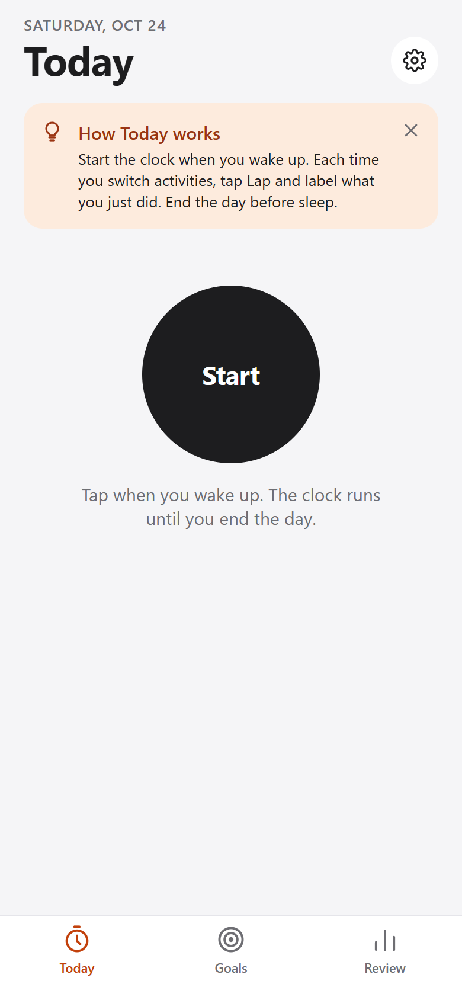<br><sub><b>Start your day</b> — with a one-time tip</sub></td>
    <td align="center" width="33%">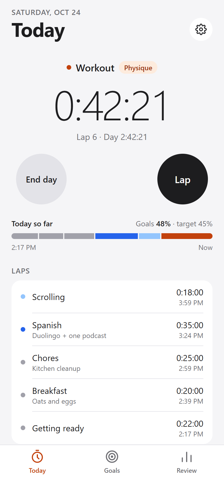<br><sub><b>Running</b> — current lap, day total, today's timeline, laps</sub></td>
    <td align="center" width="33%">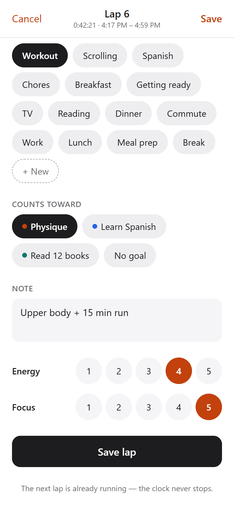<br><sub><b>Lap sheet</b> — category, goal, note, energy, focus</sub></td>
  </tr>
</table>

- The big number is the **current lap**; underneath is the lap count and how long the day has run.
- **Today so far** is your day as a strip: goals in their own color, everything else in greys. It also shows goal share vs your combined target.
- Tap the current activity's name to label it *while it's still running*.

### Goals — what you planned vs what you gave

<table>
  <tr>
    <td align="center" width="33%">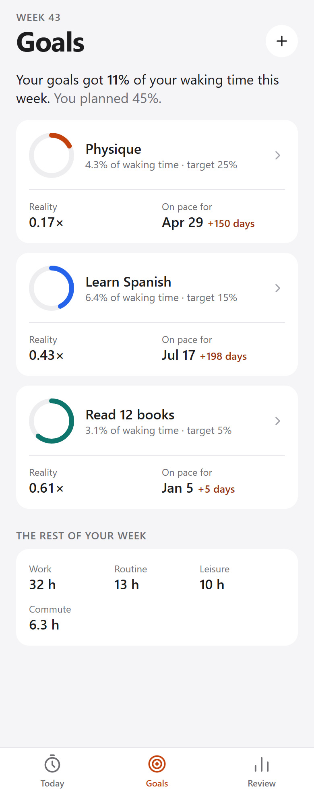<br><sub><b>Goals</b> — ring, reality ratio, real finish date</sub></td>
    <td align="center" width="33%">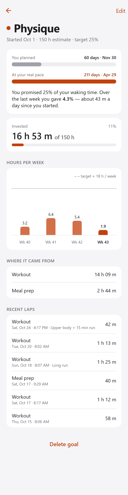<br><sub><b>Goal detail</b> — planned vs real pace, hours per week, sources</sub></td>
    <td align="center" width="33%">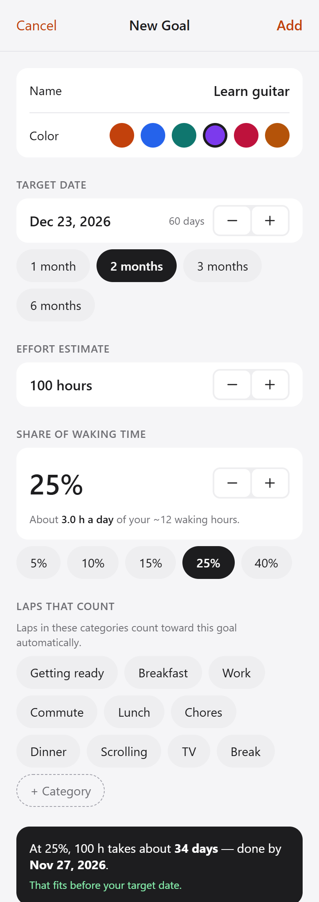<br><sub><b>New goal</b> — live check: does this plan fit?</sub></td>
  </tr>
</table>

| On a goal card | Means |
|---|---|
| **Ring** | Fills as your real share of time over the last 7 days approaches the target. |
| **Reality 0.43×** | You're giving it 43% of what you promised. `1.00×` = on plan. |
| **On pace for Dec 30 · +30 days** | When you'll finish at the pace you're actually keeping, compared with your target date. |

### Review — drill up and down

<table>
  <tr>
    <td align="center">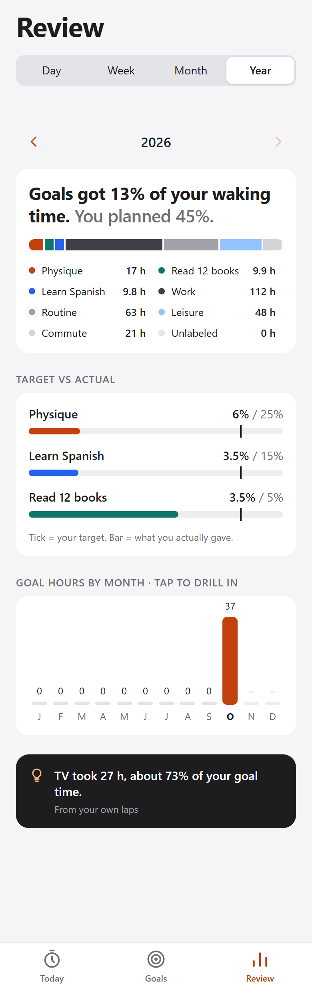<br><sub><b>Year</b> → tap a month</sub></td>
    <td align="center">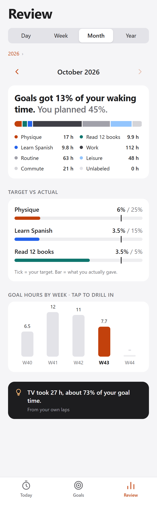<br><sub><b>Month</b> → tap a week</sub></td>
    <td align="center">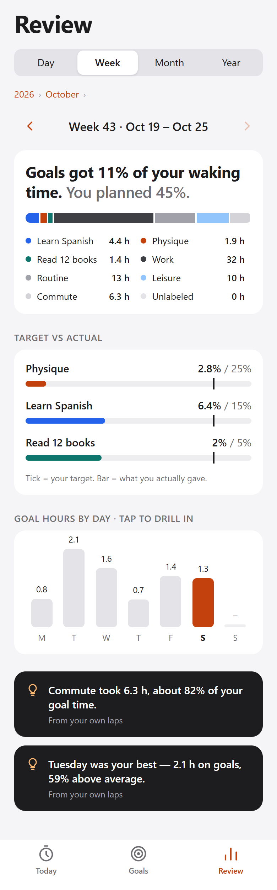<br><sub><b>Week</b> → tap a day</sub></td>
    <td align="center">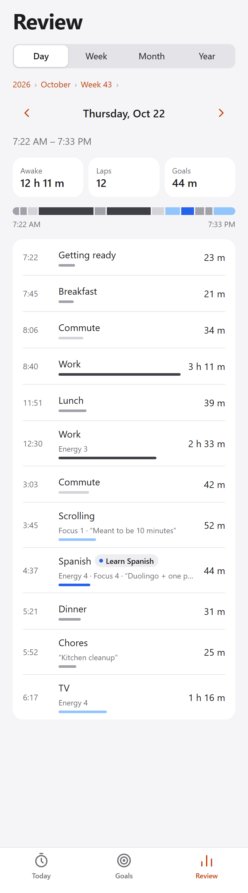<br><sub><b>Day</b> → every lap</sub></td>
  </tr>
</table>

- **Day / Week / Month / Year** switches the zoom level; the arrows step back and forward in time.
- **Tap a bar** to zoom into it. **Tap the path** above the title (e.g. *2026 › October ›*) to zoom back out.
- Each view shows where the time went, **target vs actual** per goal (the tick is your target), and plain-language insights from your own laps.

### Dark mode and settings

<table>
  <tr>
    <td align="center">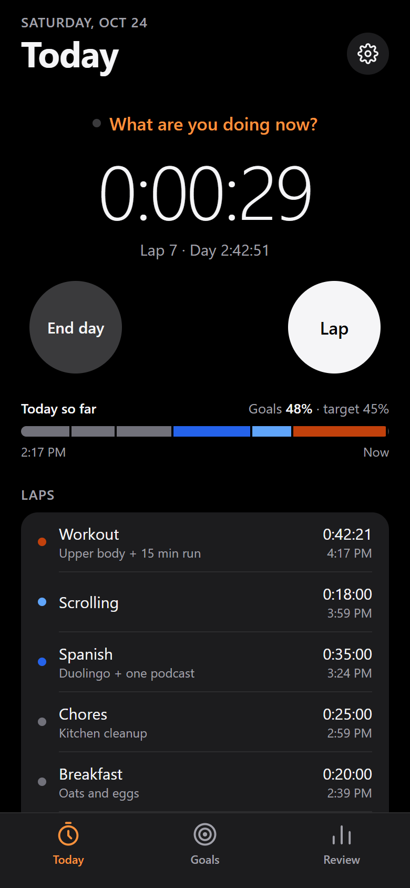<br><sub>Today</sub></td>
    <td align="center">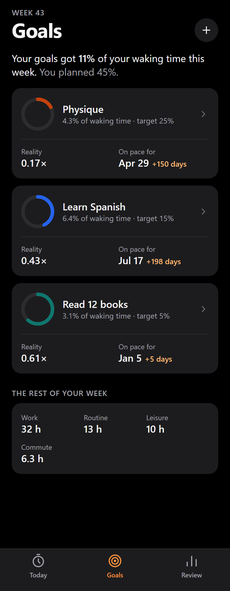<br><sub>Goals</sub></td>
    <td align="center">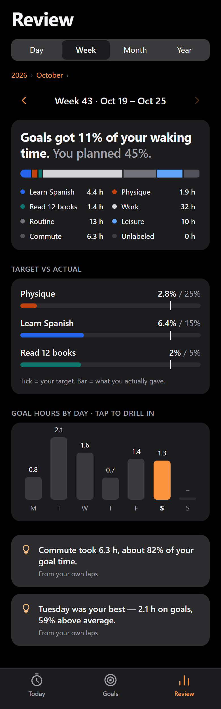<br><sub>Review</sub></td>
    <td align="center">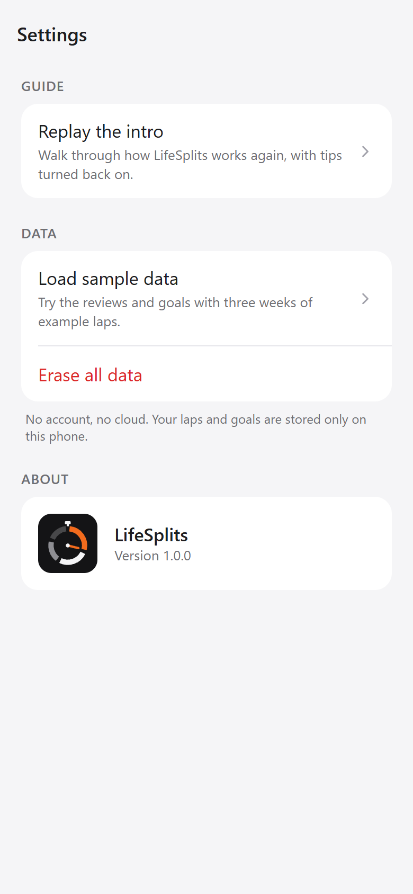<br><sub>Settings</sub></td>
  </tr>
</table>

The app follows your phone's light/dark setting automatically.

<details>
<summary><b>The app icon</b></summary>
<br>
<p>
  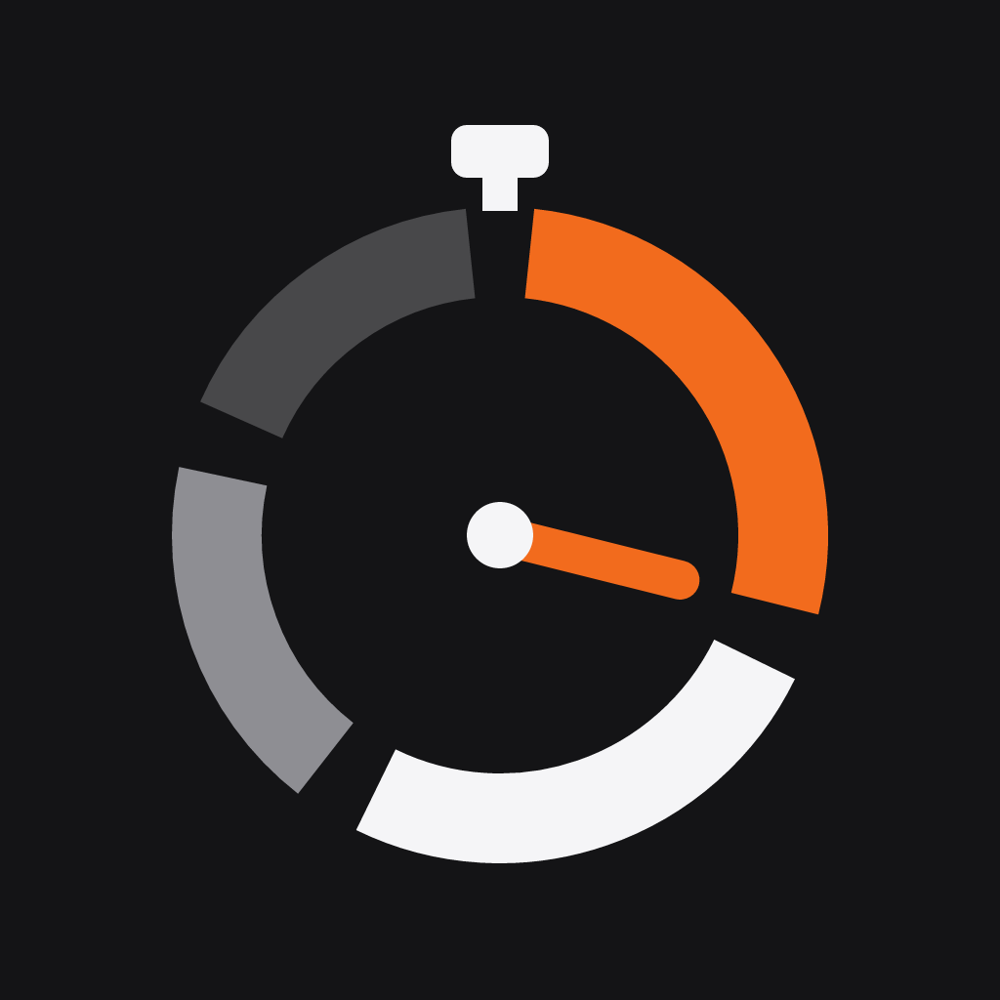
</p>

A stopwatch ring split into laps; the orange lap — and the hand — is the time you gave a goal. The icon, Android adaptive/monochrome icons, splash image and favicon are all generated from one source file, [`assets/brand/mark.mjs`](assets/brand/mark.mjs) (`npm run icons`).

</details>

## 🧮 How the numbers work

Everything is computed from lap timestamps on the phone — no server, no guesswork.

| Number | How it's calculated |
|---|---|
| **Waking time** | Time the clock was running (sessions) in the period. |
| **Goal share** | Time in laps that count toward the goal ÷ waking time. |
| **Reality ratio** | Goal share over the last 7 days ÷ target share. |
| **Invested** | All lap time toward the goal since it started. |
| **Pace** | Invested ÷ days since the goal started. |
| **Projected finish** | Today + (effort estimate − invested) ÷ pace. |
| **Slip** | Projected finish − target date (`+30 days` late, `19 days early`). |

<details>
<summary><b>Worked example</b></summary>
<br>

*Physique*: target **25%**, estimate **150 h**, started **Oct 1**, target date **Nov 30** (60 days).

By Oct 24 (23 days) you've invested **38 h 20 m** → pace ≈ **1 h 40 m / day**.
Over the last week it got **10.7%** of your waking time → reality **0.43×**.
Remaining 111.7 h ÷ 1.67 h/day ≈ **67 more days** → finish **Dec 30**, **+30 days** late.

</details>

## 🗂️ Project structure

```
src/
├── app/                    Expo Router — every file is a screen
│   ├── _layout.tsx         Root stack; switches between onboarding and the app
│   ├── welcome.tsx         Welcome screen
│   ├── intro.tsx           5-step guided intro
│   ├── (tabs)/             Today · Goals · Review (native tabs; web stand-in in _layout.web.tsx)
│   ├── lap/[id].tsx        Lap sheet (modal)
│   ├── new-goal.tsx        New / edit goal (modal, ?id= to edit)
│   ├── goal/[id].tsx       Goal detail
│   └── settings.tsx        Replay intro · sample data · erase
├── components/             UI kit (ui.tsx), icons, logo, goal card, day view
├── hooks/                  Theme, ticking clock, lap colors/names
├── lib/
│   ├── stats.ts            All analytics: share, reality, projections, drill buckets, insights
│   ├── time.ts             Date ranges and formatting
│   └── types.ts            Goal · Category · Session · Lap
└── store/
    ├── app-store.ts        Zustand store + actions, persisted
    ├── storage(.web).ts    SQLite kv-store on phones, localStorage on web
    └── sample-data.ts      Deterministic three-week demo
assets/brand/               Icon source → rendered PNGs in assets/images
docs/                       README images and the product brief
scripts/docs/               Regenerates the README screenshots
```

<details>
<summary><b>Design decisions worth knowing</b></summary>

- **Timestamps, not tickers.** A lap stores `startedAt` / `endedAt`; elapsed time is always derived. The clock survives the app being killed or the phone restarting.
- **Goals in color, life in neutrals.** Only goals get a hue, so a day's strip shows at a glance how much of it was yours (`src/constants/theme.ts`).
- **One lap can only count toward one goal**, and a category can belong to at most one goal — no double counting.
- **Local-first.** No account and no backend; all data lives on the device.

</details>

### Scripts

| Command | What it does |
|---|---|
| `npm start` | Start the dev server (Expo Go / emulators) |
| `npm run android` · `npm run ios` · `npm run web` | Start and open a specific target |
| `npm run typecheck` | TypeScript, strict |
| `npm run lint` | ESLint with the Expo config |
| `npm run icons` | Re-render icon + splash PNGs (needs `npm i --no-save @resvg/resvg-js`) |
| `npm run docs:capture` · `npm run docs:compose` | Re-shoot the README screenshots from the web build, then rebuild the hero and GIF (needs `npm i --no-save puppeteer-core gifenc @resvg/resvg-js` and the web dev server running) |
| `npx expo-doctor` | Dependency and config health check |

### Built with

[Expo SDK 58](https://docs.expo.dev) · [Expo Router](https://docs.expo.dev/router/introduction/) (native tabs, protected routes) · React Native 0.88 · TypeScript · [Zustand](https://github.com/pmndrs/zustand) · [expo-sqlite kv-store](https://docs.expo.dev/versions/latest/sdk/sqlite/) · react-native-svg · expo-haptics

## 🛣️ Roadmap

- [x] Lap clock with labels, notes, energy, focus and mood
- [x] Goals with target share, effort estimate and honest finish dates
- [x] Day / week / month / year review with drill-down
- [x] Welcome screen, guided intro, one-time tips
- [x] Light and dark mode, app icon and splash
- [ ] Tests
- [ ] Lock-screen widget / Live Activity with a Lap button
- [ ] Sleep, steps and heart rate from Apple Health / Health Connect
- [ ] Apple Watch and Wear OS apps
- [ ] Optional account and cloud sync
- [ ] CSV / JSON export

The full product thinking — competitors, metrics, risks — is in [`docs/product-brief.md`](docs/product-brief.md).

## 🔒 Privacy

No account, no cloud, no analytics. Your laps and goals are stored only on your phone, and **Settings → Erase all data** removes them.

---

<p align="center">
  <br>
  <sub>LifeSplits — plans meet reality.</sub>
</p>
